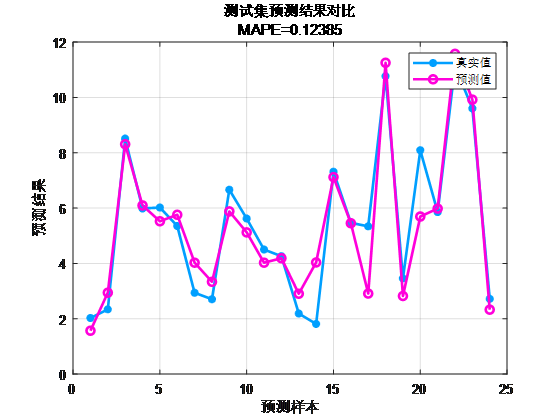
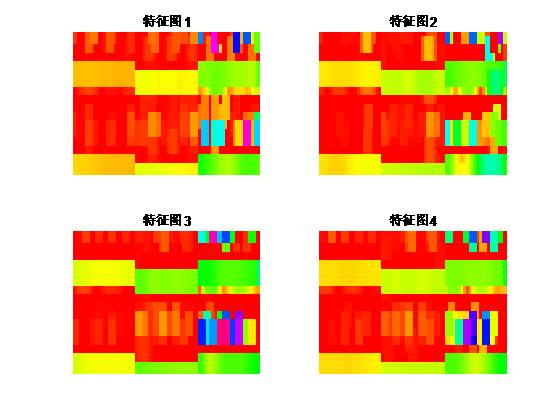
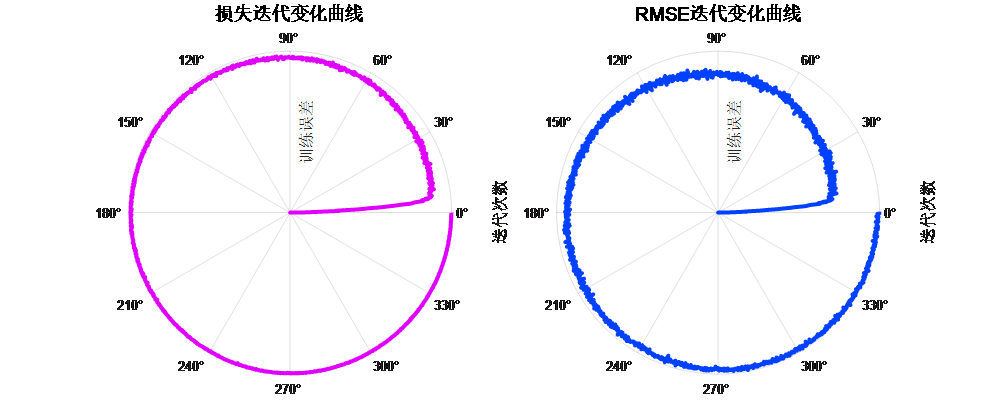
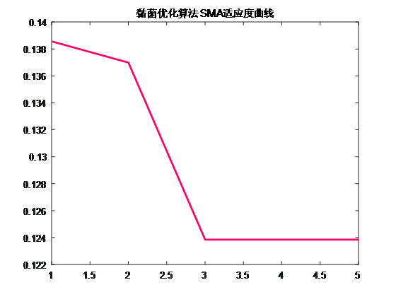

# SMA-CNN-BiGRU-Attention - Optimized Deep Learning for Entangled Fungi - Integration of Attention Mechanism Prediction Program! Visualization of Features! Direct Run!

Applicable Platform: MATLAB 2023 and above
SMA (Sticklebug Optimization Algorithm) was published in the top journal of SCI, Future Generation Computer Systems, in 2020. It utilizes this top-tier algorithm to optimize hyperparameters such as convolutional kernel size, number of BiGRU units, and learning rate in our CNN-BiGRU-Attention time-series and spatial feature combination-fusion attention mechanism regression prediction program code.
Innovations of SMA:
1. Simulation of Biological Behavior:
SMA simulates the behavior of sticklebugs in finding food, introducing intelligent biological behavior into the optimization algorithm. This method of biological behavior simulation allows the algorithm to better adapt to complex and dynamic problem domains.
2. Adaptability and Flexibility:
SMA is adaptable and flexible, capable of adjusting its search strategy according to environmental changes. The algorithm can dynamically adjust the probability of leaving the current position, search mode, and resource utilization strategy, making it more suitable for different problems and environments.
3. Multi-source Information Fusion:
SMA incorporates the idea of multi-source information fusion through the modeling of sticklebugs' utilization of multiple food sources. Sticklebugs can simultaneously utilize multiple resources, making the algorithm more robust and capable of better handling multi-objective optimization and multi-modality problems.
4. Dynamic Search Mode Adjustment:
SMA adjusts the search mode dynamically based on the quality of food sources, similar to how sticklebugs use a more focused search method in high-quality food areas and a broader exploration in low-quality food areas. This dynamic search mode adjustment enhances the algorithm's adaptability across different problem scenarios.
5. Global-Local Search Fusion:
SMA integrates global and local search strategies, similar to how sticklebugs perform localized focused searches in high-quality food areas and global exploration in overall areas. This global-local search fusion makes the algorithm more likely to escape from local optima and more able to search for potential optimal solutions with finer precision.
In summary, SMA introduces the concept of bio-inspired optimization through simulating the intelligent behavior of slime molds, enhancing the adaptability, flexibility, and diversity of the algorithm in solving complex problems. These features make SMA particularly effective in certain areas, offering a more efficient search for problem solutions compared to traditional optimization algorithms.
The innovativeness of the CNN-BiGRU-Attention model:
1. Combining Convolutional Neural Network (CNN) with Bidirectional Gated Recurrent Unit (BiGRU): The CNN is designed to process multivariate time series with multi-channel inputs, effectively capturing spatial relationships among input features. The BiGRU is a recurrent neural network capable of capturing long-range dependencies within sequences. By its bidirectionality, BiGRU can consider both past and future information simultaneously, enhancing the model's ability to perceive dynamic changes in time series.
2. Introducing Self-Attention mechanism: The Self-Attention mechanism allows the model to weight different time steps' input information more flexibly. This helps the model focus more on time points that have a greater impact on the prediction target.
The Self-Attention mechanism also facilitates handling long-term dependencies in time series, improving the model's global perception of input sequences during prediction.
Optimization application: A forward-looking 24-step multivariate time series regression prediction algorithm based on the slime mold optimization algorithm (SMA), Convolutional Neural Network (CNN), and Bidirectional Gated Recurrent Unit (BiGRU) integrated with attention mechanisms.
Functions:
1. Multivariate feature input with single sequence variable output, where the input features from the previous day are used to predict the next day, achieving a forward-looking 24-step prediction.
2. Optimizing learning rate, convolution kernel size, and number of neurons using the SMA optimization algorithm, aiming to minimize MAPE as the objective function.
3. Providing loss and RMSE iteratively changing polar coordinates graphs; network feature visualization graphs; test comparison graphs; fitness curve (if the initial precision is highest, then the fitness curve will be a horizontal line).
4. Provide MAPE, RMSE, MAE, etc. for calculation results display.
Applicable fields: Wind speed prediction, photovoltaic power prediction, power generation prediction, carbon price prediction, and other applications.
Comparison between predicted values and actual values:
\n        \n      Visualization of training features:
\n        \n      Errors from inside to outside in polar coordinates form of the training curve (error approaching zero from within)
\n        \n  
Fitness curve:
\n        \n  
\n

## Images

<!-- PAYMENT_BLOCK -->

## Get this dataset

- Payment link (Stripe): [Buy now](https://buy.stripe.com/3cs8yP7sY87d0vu9AB)
- Payment QR code: 

<!-- /PAYMENT_BLOCK -->
